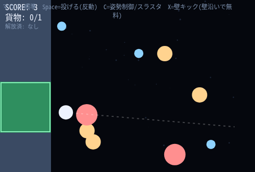

# recoil-sweep

**掃除道具は、唯一の推進剤でもある。**

無重力のステーション外壁。デブリを拾ってエアロックへ届けると掃除できるが、
あなたにはエンジンが無い。動く手段は、拾ったデブリを投げて**その反動で飛ぶ**ことだけ。

単一 HTML / Canvas 2D / 外部依存なし。`index.html` をブラウザで開く。

| 操作 | 内容 |
|---|---|
| マウス | 照準 |
| Space | 持っているデブリを照準方向へ投げる(自分は逆向きに反動で動く) |
| C | 姿勢制御(弱い。常時使える) / スラスタ(解放後は強い。燃料消費) |
| X | 壁キック。壁に触れている間だけ使える無料の反動移動(短いクールダウンあり) |

---

## 中核

拾う・投げるは同じひとつの物理(運動量保存)で動いている。

- **拾う**: プレイヤーとデブリの非弾性衝突。質量比に応じた合成速度になる。
- **投げる**: 照準方向へ固定の力積を与える。デブリは加速し、プレイヤーは**正確に逆方向**へ加速する。

つまり「掃除したいデブリ」は同時に「今ここで使える唯一の燃料」でもある。
エアロックの近くで投げてしまえば移動の足しにはなるが、届けた分のスコアは失う。
運ぶほど、抱えた質量ぶんだけ次の反動は弱くなる — 多く持てば移動効率は落ちる。

最初はデブリを1個しか持てず、投げるものが無いと自力では動けない。これを
解決するため、常時使える弱い姿勢制御(C)を最初から持たせてある
(解放後の強スラスタより遥かに非力)。

もう一つの初手の足として、**壁キック(X)** がある。船体やステーションの外周に
触れている間だけ、デブリを消費せずに壁を蹴って反動で飛べる(短いクールダウンあり)。
デブリの投擲が「持っている資源を消費する移動」であるのに対し、壁キックは
「その場にある構造物を踏み台にする、無料だが壁際限定の移動」という別枠の手段にしてある。
プレイヤーは最初から船体の壁に接した位置に立っており、何も拾う前からこの壁キックで
船外へ飛び出せる。

外周とステーション間の間隔は意図的に狭くしてある。壁から壁までの往復が近いほど、
壁キックで弾みをつけて横断する動きが毎回のプレイに絡んでくる。

## スキル解放ループ

エアロックに届けてスコアを稼ぐと、閾値ごとに解放される。

| スコア | 解放 |
|---|---|
| 5 | 貨物容量 +1 (同時に2個まで保持可能) |
| 12 | 強スラスタ (燃料ゲージあり、C長押しで強い推進) |
| 22 | マグネット回収 (近くのデブリを自動で引き寄せる) |

## 設計メモ(将来の3D化に向けて)

今は Canvas 2D のみだが、物理コア(位置・速度・壁)は内部的に x/y/z のベクトルとして
持っている(z は常に 0)。壁も軸(x/y/z)ごとのデータ(`makeWall(axis, side, boundary)`)
として定義し、反射処理(`wallGap` / `wallBounce`)は軸に依存しない汎用コードにしてある。
3D化するときは奥行き方向の壁(`makeWall('z','min',...)` / `makeWall('z','max',...)`)を
`OUTER_WALLS` に追加するだけで、この反射ロジック自体は変更しなくて済むはずの構成にした。
一方、マウス照準(`aimAngle`)はスクリーン平面前提の `atan2` のままなので、3D化する際は
入力(カメラ視点からの方向ベクトル生成)と描画(奥行きの投影)側だけ作り直しが必要になる。

## 実測検証

`tools/smoke-test.mjs` — 依存ゼロのCDPクライアントでヘッドレスChromeを実走させ、
実際のマウス/キーボード入力で「拾う→運ぶ→エアロックで納品→スコア加算」と
「投げた瞬間に運動量保存どおり逆方向へ反動が付く」を通しプレイで確認する。
`tools/unlock-test.mjs` — スコア閾値(5/12/22)で容量・スラスタ・マグネットが
狙いどおり解放されることを確認する。
`tools/wallkick-test.mjs` — 壁キックが「壁に触れている時だけ無料で反動が付き、
離れていると発動しない」こと、クールダウン中の連打が効かないことを確認する。

```
node tools/smoke-test.mjs
node tools/unlock-test.mjs
node tools/wallkick-test.mjs
```


